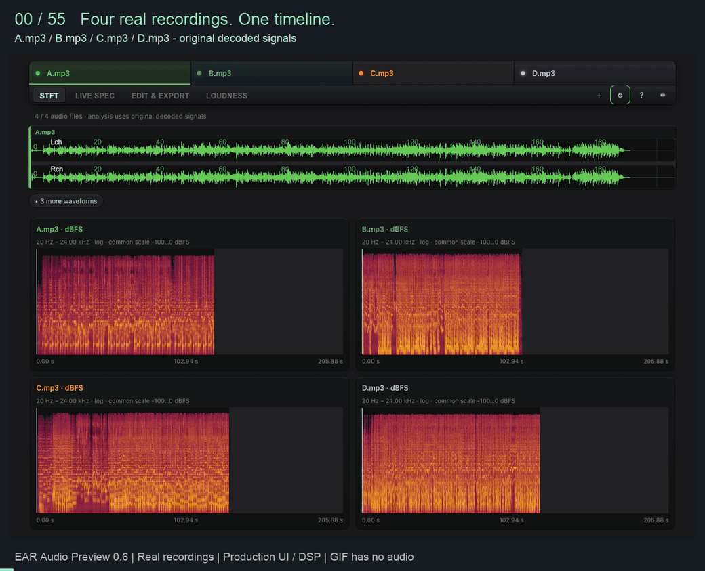
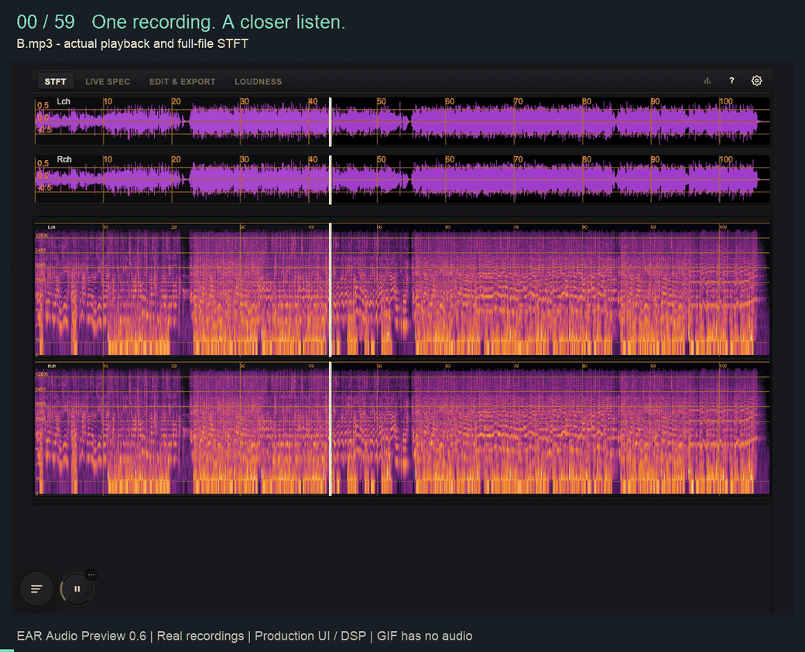

<div align="center">
  
  <h1>EAR Audio Preview</h1>
  <p><strong>直接在编辑器里试听、分析和比较音频。</strong><br>支持 VS Code 和 Cursor，可同时比较八份音频。</p>

[](https://marketplace.visualstudio.com/items?itemName=Eps-Acoustic-Revolution-Lab.ear-audio-preview)
[](https://github.com/Eps-Acoustic-Revolution-Lab/EAR-Audio-Preview/actions/workflows/ci.yml)
[](LICENSE)

[English](README.md) · **简体中文**

[快速开始](#快速开始) · [核心场景](#核心场景) · [本版更新](#v060-更新) · [为什么选择-ear](#为什么选择-ear) · [开发指南](#开发指南)
</div>

> **开发手记：** [技术博客](doc/blog/)记录了开发中遇到的问题和实现思路，包括 CQT 频谱设计、GPU 频谱图渲染等。

## 简介

EAR Audio Preview 是一款音频分析插件，集成波形、频谱图、实时立体声分析和响度测量。你可以单独试听，也可以同步播放、比较最多八份音频，用于检查模型输出、抽查数据集、挑选音效或比较混音版本。

**八份音频同步比较 · FFT + CQT · LUFS / LRA / 真峰值 · 耳机频响校正 · 音频本地处理**

## 快速开始

### 安装

在扩展面板搜索 **EAR Audio Preview**，或从终端安装：

```sh
code --install-extension Eps-Acoustic-Revolution-Lab.ear-audio-preview
```

[从 Marketplace 安装](https://marketplace.visualstudio.com/items?itemName=Eps-Acoustic-Revolution-Lab.ear-audio-preview) · [下载 VSIX](https://github.com/Eps-Acoustic-Revolution-Lab/EAR-Audio-Preview/releases)

### 开始使用

1. **打开试听。** 打开音频文件，按 **空格** 播放。如果默认进入其他编辑器，选择 **Reopen Editor With… → Audio Preview**。
2. **查看细节。** 在 STFT 频谱图上拖选区域放大。切到 **Live Spec** 查看播放时的频谱与声像，或在 **Loudness** 中计算响度、基频与起音曲线。
3. **比较版本。** 在资源管理器中选中 **2–8 份单／双声道音频**，右键选择 **EAR Audio: Compare Files**。各轨同步播放，用静音按钮选择要听的轨道。

首次打开时会显示操作引导，点击工具栏的 **`?`** 可再次查看。比较视图中，**Ctrl/Cmd + 拖选**只缩放时间，**Shift + 拖选**只缩放频率，双击恢复视图。右键图表可切换布局或全屏。

支持 **WAV、MP3、AAC、OGG、FLAC、OPUS、M4A、SPH**。[完整使用指南](doc/usage.md) · [设置参考](doc/configuration.md)

## 核心场景

### 比较模型输出或混音版本

将模型输出、处理前后的音频或混音版本放在一起，拖选区域即可同步缩放各轨频谱图。切到 Live Spec，按轨道颜色查看叠加的频谱、立体声场与相位相关度。参考音频静音后仍可参与分析，便于边听当前版本边对照。



### 响度分析与耳机校正

在 Loudness 中测量响度和真峰值，查看基频与起音曲线。Monitor 可分别监听左右声道（L/R）、中侧声道（M/S）或指定频段，也能应用耳机频响校正。开启或旁路校正，即可比较前后的听感。



### 功能一览

| 工作区 | 可以做什么 |
| --- | --- |
| **STFT** | 波形与 GPU 加速频谱图，支持线性、对数、Mel 或混合频率轴，以及拖选缩放、联动比较和全屏查看。 |
| **Live Spec** | 实时 FFT/CQT 频谱、峰值保持、三种声场显示模式，以及逐频段相位相关度。 |
| **Loudness** | LUFS、LRA、PLR 与真峰值测量，以及共用时间轴的响度、基频（F0）和起音曲线。 |
| **Edit & Export** | 导出选区音频或多轨混音，支持选择采样率、声道及 PCM8/16/24 或 float32 WAV 编码。 |
| **Monitor** | L/R/M/S 监听、五频段独听，以及 AutoEq 耳机校正预设的搜索与导入。 |

<a id="whats-new"></a>

<!-- release:zh:start -->
## v0.6.0 更新

- **先对齐，再比较。** 估计两份同采样率音频的整数固定延迟，确认后应用到播放、分析和导出的会话副本，也可重置；极性补偿可选，原文件不变。

- **八文件同步比较。** 共用播放时钟，联动缩放波形与 STFT；每轨可独立聚焦、静音或停用。
- **实时频谱叠加。** 比较 FFT/CQT 频谱、立体声场与相位相关度，并查看 LUFS、基频和起音曲线。
- **电平匹配与差异测量。** 按共用选区匹配 RMS，只衰减、不放大；以聚焦文件为参考，测量同采样率音频的残差 RMS 与峰值。
- **选区混音导出。** 选择片段、采样率、声道及 PCM 或 float32 WAV 编码，导出多轨混音，也可写入已启用的耳机 EQ。
- **界面与体积优化。** 统一控件与监听入口，提供悬浮 Monitor、耳机校正和交互式比较引导，安装包缩小 48%。
- **诊断更可靠。** 修正声场图的方向、信号极性与边界插值；损坏的耳机 EQ 配置会安全回退，不再中断音频预览。
<!-- release:zh:end -->

[完整更新历史](CHANGELOG.md)

## 为什么选择 EAR

同时试听多个版本，分别查看各轨的频谱、声场和响度。下面是 EAR 与三款同类音频插件的能力对比。

| 能力 | **EAR** | [audio-preview](https://marketplace.visualstudio.com/items?itemName=sukumo28.wav-preview) | [Audio Player](https://marketplace.visualstudio.com/items?itemName=huachao.audio-player) | [audioscope](https://marketplace.visualstudio.com/items?itemName=YongsooIm.audioscope) |
| --- | :---: | :---: | :---: | :---: |
| 波形与 STFT 频谱图 | ✓ | ✓ | 仅波形 | ✓ |
| 同屏文件比较 | **8 份并行** | 单文件 | 多文件 | 双文件 A/B |
| 跨文件 STFT 联动缩放 | ✓ | — | — | ✓ |
| 多轨实时频谱叠加 | ✓ | — | — | — |
| 实时 FFT / CQT 与峰值保持 | ✓ | — | — | — |
| 立体声场图 | ✓ · 3 种模式 | — | — | — |
| 逐频段立体声相关度 | ✓ | — | — | — |
| LUFS / LRA / 真峰值 | ✓ | — | — | ✓ |
| 基频与起音时间线 | ✓ | — | — | — |
| L/R 与 M/S 实时 RMS／峰值电平表 | ✓ | — | — | — |
| L/R/M/S 声道监听 | ✓ | — | — | — |
| 五频段独听 | ✓ | — | — | — |
| AutoEq 耳机频响校正 | ✓ | — | — | — |
| 选区 WAV 导出 | ✓ | ✓ | — | ✓ |
| 共用选区 RMS 电平匹配 | ✓ | — | — | ✓ |
| 同采样率残差 RMS／峰值 | ✓ | — | — | ✓ |
| 耳机 EQ 写入 WAV 导出 | ✓ | — | — | — |
| 自动时间对齐 | ✓ | — | — | ✓ |

✓ 支持；— 对比版本未提供。[版本与功能说明](doc/comparison.zh-CN.md#能力对比)。

静音参考轨仍可参与分析，保留频谱对照；声道切换、频段独听和耳机校正用于监听，测量不受监听设置影响。应用 Align 后，测量基于对齐后的会话副本。

**预览、分析与安装包体积。**

- **STFT 吞吐量提升 21–28%**：相比 audio-preview，3 秒音频分析约需 **25 ms**。
- **预览等待时间减少约 85%**：60 秒立体声音频的打开耗时，从 audio-preview 的约 **1.60 秒降至 0.25 秒**。
- **下载体积缩减 48%**：经过包体优化，安装包从 **6.66 MiB 降至 3.44 MiB**。

[与六款音频插件的完整对比](doc/comparison.zh-CN.md) · [性能数据](doc/comparison.zh-CN.md#仓库原有-benchmark-全套结果)

## 技术亮点

### 保留瞬态边缘的频谱图

WebGL2 渲染器在时间方向保留瞬态边缘，在频率方向通过插值平滑谐波线条。FFT 窗长可自动调整，也可手动选择窗长和窗函数，便于观察不同声音的细节。[频谱图渲染的设计过程](doc/blog/anisotropic-spectrogram-rendering.md)

### CQT 频谱与峰值保持

CQT 视图参考 PAZ 的频带与曲线设计，采用可变 Q 频带，便于观察低频能量分布。频谱倾斜、释放速度与峰值保持均可调节。[CQT 频谱的设计与实现](doc/blog/cqt-spectrum-analyzer.md)

### 可重置的音频对齐

在比较页点击 **Align**，估计两份同采样率音频的延迟，确认后再应用。搜索前 60 秒内 ±2 秒的整数固定延迟，播放、图表与导出共用移动后的会话副本；重置可恢复原始解码音频。当前不处理分数延迟或时钟漂移。[设计、失败案例与消融](doc/blog/audio-alignment-dsp.md) · [使用说明](doc/audio-alignment.md)

### 按各轨采样率分析

各轨按解码后的采样率分析，结果绘制在统一的时间与频率坐标上。STFT 使用相同的绝对 dBFS 色阶，便于直接比较各轨的频谱能量。

[文档导航](doc/README.md) · [架构说明](doc/knowledge-base/architecture.md) · [音频 DSP](doc/knowledge-base/audio-dsp-chain.md) · [实时监听](doc/live-monitoring.md)

## Roadmap

### 已完成

- [x] **基础功能：** 分格式 WASM 解码、WebGL2 频谱图、立体声电平表与相位相关度分析。
- [x] **v0.2：** 四个工作区、响度／基频／起音时间线与选区导出。
- [x] **v0.3：** AutoEq 耳机校正，支持全局和工作区预设。
- [x] **v0.4：** 参考 PAZ 设计的 CQT 频谱与峰值保持。
- [x] **v0.5：** 频谱图各向异性渲染与交互式上手引导。
- [x] **v0.6：** 八文件并行播放、STFT 联动缩放与实时分析叠加。
- [x] **v0.6：** 逐文件响度与特征分析、共用 Monitor 控件与选区混音导出。

- [x] **v0.6：** 共用选区 RMS 匹配、同采样率残差测量与可选的耳机 EQ 导出。

- [x] **v0.6：** 同采样率整数固定延迟对齐，同步作用于播放、分析和导出，可重置并可选补偿极性。

### 待办

- [ ] Chroma 时间线，或使用 PredominantPitchMelodia 估计复音音乐的旋律。
- [ ] 可选的特征曲线，例如频谱质心（Spectral Centroid）。
- [ ] A/B/C 计权 RMS。
- [ ] 将单文件长音频的基频／起音计算迁移至 Worker。

[完整更新历史](CHANGELOG.md) · [提出功能建议](https://github.com/Eps-Acoustic-Revolution-Lab/EAR-Audio-Preview/issues)

## 开发指南

```sh
git clone https://github.com/Eps-Acoustic-Revolution-Lab/EAR-Audio-Preview.git
cd EAR-Audio-Preview
npm ci
npm run webpack-dev
```

按 **F5** 启动扩展开发宿主，再打开音频文件。运行 **`npm run ci`** 完成检查与打包，或使用 **`npm run vsix`** 构建可安装的扩展。

欢迎提交问题、功能建议与 PR。[反馈问题](https://github.com/Eps-Acoustic-Revolution-Lab/EAR-Audio-Preview/issues) · [开发与发布流程](doc/development.md) · [测试架构与扩展指引](doc/testing.md)

## 致谢与许可证

由 [Eps Acoustic Revolution Lab](https://github.com/Eps-Acoustic-Revolution-Lab) 开发维护，源自 [sukumo28/vscode-audio-preview](https://github.com/sukumo28/vscode-audio-preview) 音频预览扩展。

使用 Ooura、Essentia.js、twgl.js、wasm-audio-decoders、loudness-worklet 与 ebur128-wasm 等开源项目。

项目采用 [MIT 许可证](LICENSE)，第三方库保留各自许可证。
